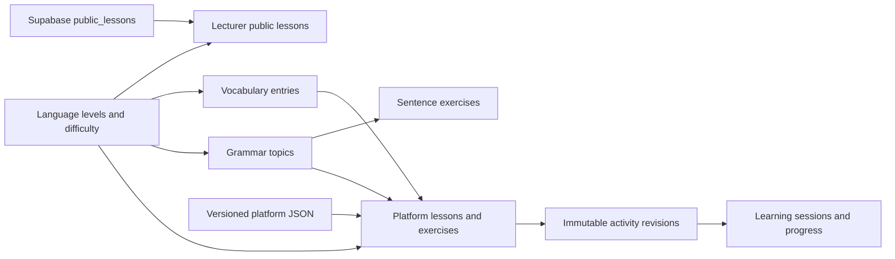

# Educational content model

The platform curriculum is a validated, versioned JSON catalog. The browser and Android build use the same catalog and generic exercise runner. Lecturer-authored public reading lessons remain in Supabase. There is no new platform content administration interface in this change.

## Models and boundaries



| Model | Important fields | Storage |
| --- | --- | --- |
| EducationalMetadata | `languageLevel`, `difficulty` | Shared TypeScript contract |
| PlatformLesson / PlatformExercise | ID, revision, kind, publication, prerequisites, grammar/vocabulary references, explanations, examples, questions, map placement | `activities.json` |
| GrammarTopic | ID, level/difficulty, explanation, examples, prerequisite topics | `grammar.json` |
| VocabularyEntry | Stable ID, characters, pinyin, meaning, topic, level/difficulty, source and source-entry ID, optional traditional spelling/part of speech | Normalized public snapshot + `vocabulary-extra.json` |
| SentenceContent | Stable ID, tokens, accepted orders, translation, level/difficulty, grammar-topic reference and annotated parts | `sentences.json` |
| LecturerLesson | UUID, lecturer author, title/summary/plain text, publication and shared level/difficulty | Supabase `public_lessons` |
| LearningSession | Stable activity ID, optional `contentRevision`, answers, hints and dates | Existing per-account progress |

`src/types/content.ts` defines these contracts. Existing `types/study.ts`, `types/learning.ts` and `types/auth.ts` re-export compatible names. `src/data/catalog.ts` provides lookups and derives practice words from vocabulary IDs; presentation code does not contain lesson-specific answer keys. The old `data/learning.ts` and `data/sentences.ts` modules are compatibility adapters.

Language levels are the same beginner/elementary/intermediate/advanced IDs used by account onboarding. Difficulty uses gentle/balanced/challenging. Labels, descriptions, topics, map lines, source records and vocabulary selection are in `taxonomy.json`. These are editorial app classifications, not placement-test results or CEFR equivalences. Vocabulary `level` retains its older meaning: an **HSK 2.0 source level**, or `null` for an authored word without that classification. It is not the gamification points level. The source-to-proficiency mapping is an explicit editorial configuration.

Platform content has `source: "platform"`; lecturer lessons have `source: "lecturer"` assigned by the Supabase adapter. A lecturer lesson shares metadata and Chinese text conventions, but it does not acquire platform prerequisites, answer keys, course-map placement or course completion rights. A published lecturer lesson is visible to signed-in users according to the existing RLS policies. The new classification columns do not change ownership, roles or publishing permissions.

## Add a lesson or exercise

Append a record to `src/data/content/activities.json`, using an existing record as a template. Use a new stable ID and question IDs; set `revision: 1`, `source: "platform"`, `publication: "published"` and `kind: "lesson"` or `"exercise"`.

Set the language level, difficulty, topic, objectives, explanation paragraphs and examples. Link `vocabularyIds` and `grammarTopicIds` to catalog entries; link prerequisites to platform lesson IDs. For course lessons, set a map line and non-negative map coordinates. The map sizes itself from those coordinates. Independent exercises normally have an empty prerequisite list. Content can use the existing `choice` and `order` question types without changing the runner.

A choice answer references an option ID. Every accepted ordering must contain exactly the same token occurrences as the token bank, including repeated words and punctuation. A `tone-guide` teaching feature can be enabled through `features`, rather than a special lesson ID. A wholly new interaction type still needs implementation; JSON cannot define new executable UI behaviour.

Add reusable language explanations to `grammar.json`. Sentence exercises reference a topic through `grammarTopicId`; their note/title is derived from that topic. Lesson-specific context and examples remain on the activity, so sharing a concept does not force unrelated examples to be identical.

Validate and build:

```sh
npm run content:check
npm test
npm run build
```

The new lesson/exercise appears in the catalog, level/difficulty filters and normal navigation without adding IDs or routes to application logic. Existing activity ordering remains the editorial order in the data file.

## Add vocabulary without editing application logic

Add original teaching vocabulary to `src/data/content/vocabulary-extra.json`, for example:

```json
{
  "id": "platform:nihao",
  "hanzi": "你好",
  "pinyin": "nǐ hǎo",
  "meaning": "hello",
  "categoryId": "other",
  "languageLevel": "beginner",
  "difficulty": "gentle",
  "level": null,
  "sourceId": "hanzi-original"
}
```

Then run:

```sh
npm run content:prepare
npm run content:check
npm run build
```

Preparation copies missing offline character templates from the already installed Hanzi Writer Data package, retains old assets and includes the existing licences. It validates all required templates before writing. If a character is absent from the package, provide a compatible, licensed template in `src/data/strokes/` before building. Word additions are data changes plus asset preparation; no component/algorithm edit is required.

The original public vocabulary snapshot remains in `src/data/vocabulary-hsk1.json` with source attribution, licence and provider IDs. Its filename is retained for compatibility. To import more public vocabulary, update the configured `vocabularySelection.hsk2Levels`/mapping and use `npm run data:import`. `npm run data:import -- --file path/to/dataset.json` imports a local provider-format snapshot without downloading. Imports keep existing IDs/characters and prepare stroke assets. The runtime Refresh vocabulary operation only refreshes the compatible shipped public selection; it retains authored vocabulary and does not silently introduce words with missing offline assets.

## Preserve published content and progress

Existing activity IDs, all original question IDs/answer keys, all 150 original word IDs (including `wo`, `hao`, `shui`), prerequisites and sentence IDs are retained. Neither the progress storage key nor backup version changes. An old session with no `contentRevision` is interpreted as revision 1.

When changing a published question bank, keep its previous record and append the same activity ID with the next revision number. Mark superseded records `archived`; the highest revision is offered for new practice when it is `published`. Do not remove historical revisions or reuse a word ID for different characters. Removing an activity from browsing means archiving its latest revision, not deleting its history. `content:check` preserves the original compatibility contract, and catalog validation requires revision 1 to remain available.

New sessions record their revision. Old unfinished sessions resume their original questions; completed sessions are scored against their original answer keys. A retry starts the latest revision. Completion already earned on an older revision continues to unlock prerequisites. Merging the same session ID with conflicting revisions is rejected. Practice histories, flashcard review schedules, per-account separation and profile goals remain intact.

## Validation and future administration

`npm run content:check` runs before production builds. It checks supported schema/ownership, stable/unique IDs, revisions, language levels, difficulty, reference integrity, acyclic prerequisites, valid question options/token inventories and required offline strokes. `tests/fixtures/content-v1.json` freezes original identities and question contracts. Tests also cover legacy backups, revision scoring, data-only additions and lecturer classification permissions.

This is the content foundation, **not** a database editor or automatic live curriculum sync. Platform content changes are reviewed/versioned and distributed in a new build. A future admin service can implement the same catalog/repository contract and publication/versioning rules instead of coupling the UI to separate database models. Published answer banks should remain versioned on that backend; a future adapter must preserve old revisions needed by progress.

For the current lecturer metadata persistence, run `supabase/migrations/20261101120000_content_classification.sql` once after the earlier migrations, then deploy. It adds defaults to existing public lessons and column grants under existing ownership policies; it does not delete or convert lessons into platform content.
